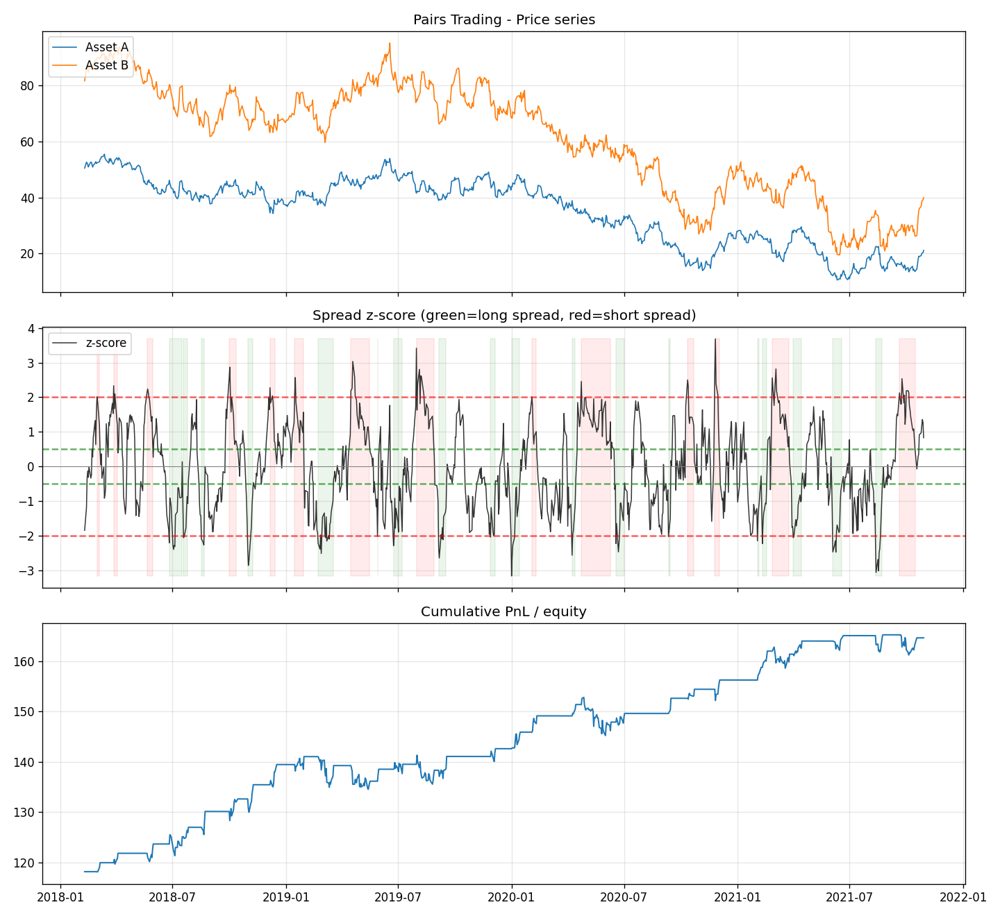

# Statistical Arbitrage — Pairs Trading

[](https://www.python.org/)
[](https://docs.pytest.org/)
[](LICENSE)
[](https://www.statsmodels.org/)

A complete **pairs-trading / statistical-arbitrage** research pipeline: detect
cointegration, estimate the hedge ratio, build a mean-reversion signal from the
spread's z-score, and backtest it with transaction costs — end to end, fully
offline.

## Methodology

### 1. Cointegration (Engle-Granger two-step)

Two price series can each be non-stationary (random walks) yet move together in
the long run. Formally, `A` and `B` are **cointegrated** if some linear
combination `B − β·A` is stationary. We detect this with the Engle-Granger
procedure:

1. **OLS** regress `B` on `A`: `B = α + β·A + ε`. The slope `β` is the
   **hedge ratio**.
2. **Augmented Dickey-Fuller** test on the residual `ε`. Rejecting the unit-root
   null (p < 0.05) means the spread is stationary → the pair is cointegrated and
   tradeable.

### 2. Spread & half-life

The tradeable spread is `s = B − β·A`. Its mean-reversion **half-life** is
estimated from an AR(1) fit (`Δs_t = λ·s_{t−1} + …`, half-life `= −ln2 / ln(1+λ)`),
telling us the natural holding horizon.

### 3. Z-score signal

Standardise the spread with a rolling mean/std to get `z = (s − μ)/σ`, then:

| Condition | Action |
|-----------|--------|
| `z > +entry` | short the spread (short B, long β·A) |
| `z < −entry` | long the spread (long B, short β·A) |
| `\|z\| < exit` | close the position |

The position logic is **stateful** — a position is held until the exit band is
crossed — which avoids whipsawing around the entry threshold.

### 4. Backtest

PnL accrues from holding the previous day's position through the spread's daily
change (no look-ahead). **Transaction costs** in basis points of the traded
notional are charged on every position change. Returns are normalised by the
average gross notional of one spread unit, so the reported Sharpe/return reflect
the capital actually deployed.

## Installation

```bash
pip install -r requirements.txt
```

## Usage

```bash
# Synthetic cointegrated pair (writes data/sample_pair.csv on first run)
python run_statarb.py

# Bring your own pair (CSV with a date index and columns A, B)
python run_statarb.py --csv data/sample_pair.csv --window 30 --entry 2.0 --exit 0.5 --cost-bps 1
```

A bundled sample pair is written to `data/sample_pair.csv` so the project is
reproducible without any external data.

## Sample results

On the bundled synthetic cointegrated pair (β = 1.5, spread half-life ≈ 11 days):

| Metric | Value |
|--------|------:|
| Hedge ratio (recovered) | 1.63 |
| ADF p-value | 1.8e-06 (cointegrated) |
| Annualized return | 10.2% |
| Sharpe ratio | 1.27 |
| Max drawdown | −5.0% |
| Number of trades | 64 |
| Win rate | 54% |



*Top:* the two price series. *Middle:* the spread z-score with entry/exit bands
(green shading = long spread, red = short). *Bottom:* cumulative PnL.

## Testing

```bash
python -m pytest -q      # 12 tests
```

Tests validate that a constructed cointegrated pair is **detected** while
independent random walks are **rejected**, that the OLS **hedge ratio is
recovered** to the true β, that the half-life is finite and positive, that
signals are correctly ternary and enter/exit at the bands, and that
**transaction costs reduce PnL** while a clean pair is profitable.

## License

MIT — see [LICENSE](LICENSE).
